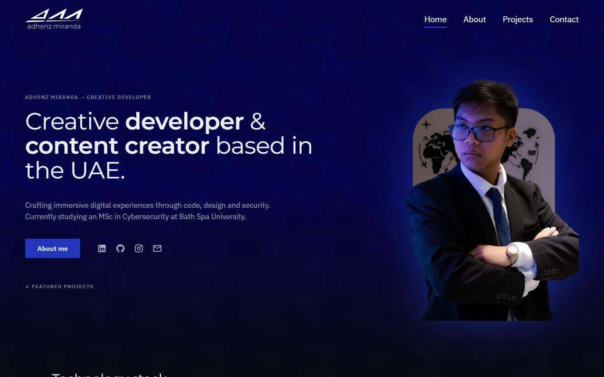
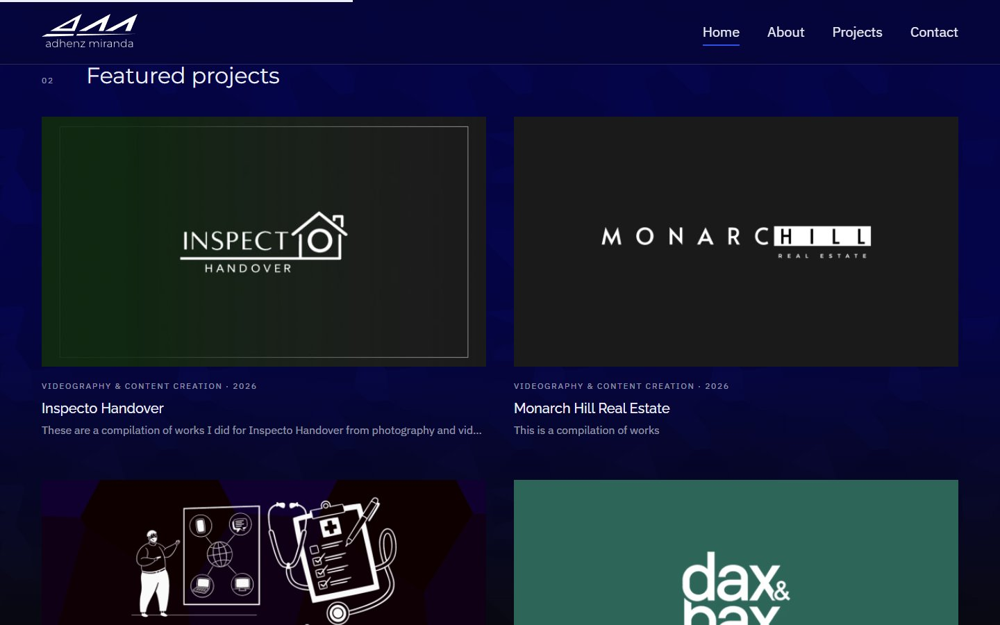
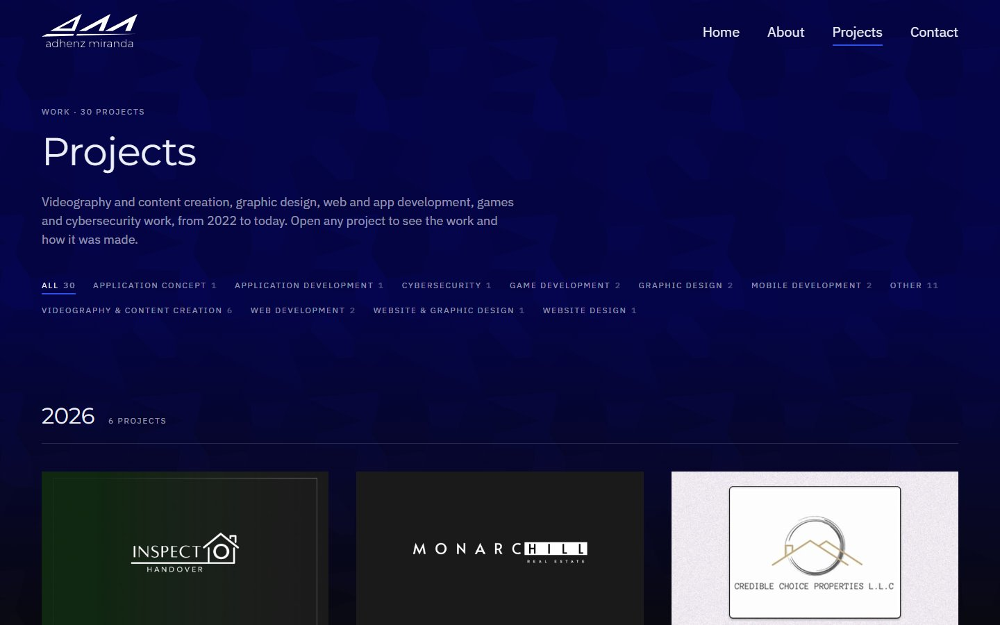
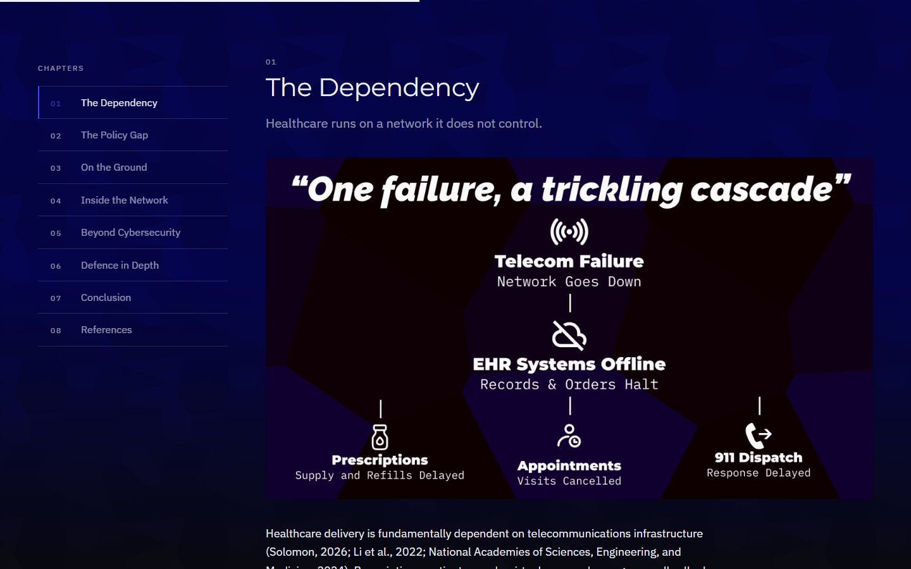
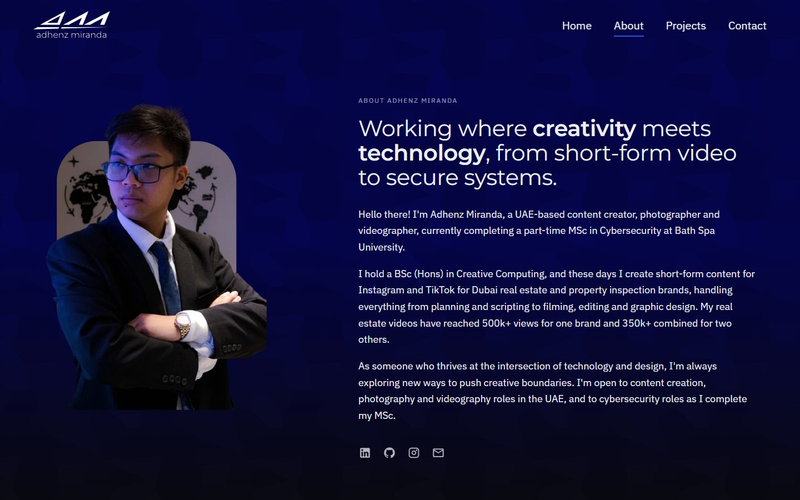
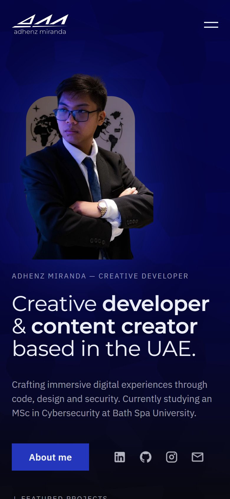
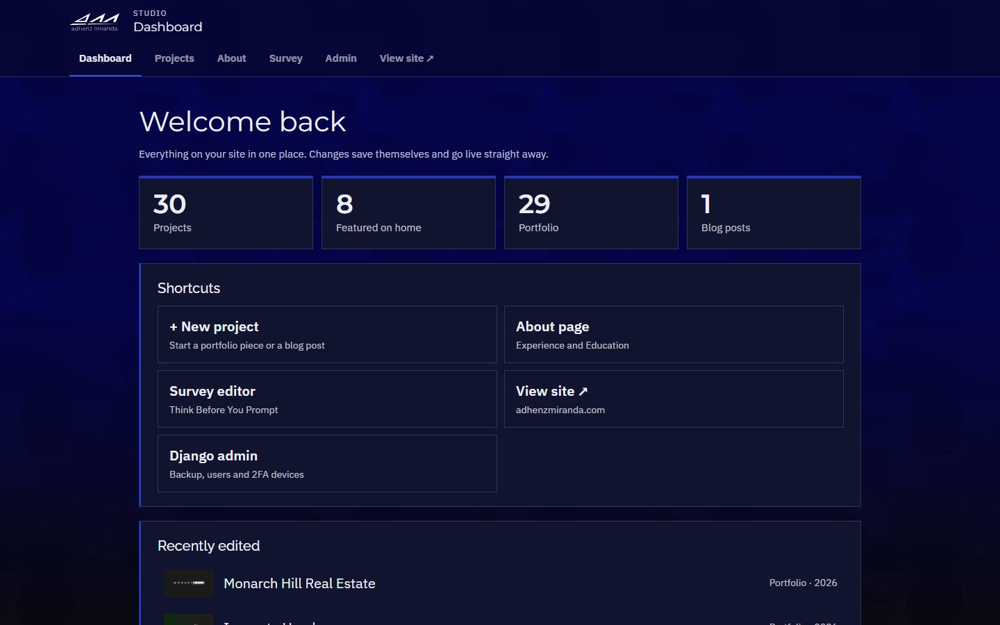
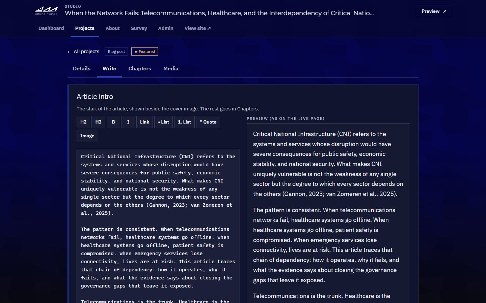

# Adhenz Miranda: portfolio website

The source code of **[adhenzmiranda.com](https://adhenzmiranda.com)**, the portfolio of Adhenz Miranda, a UAE-based creative developer and content creator studying an MSc in Cybersecurity.

It's a Django site with its own website builder, **Studio**, so projects, blog posts, media and the About page are all edited in a friendly interface instead of the Django admin. It also hosts the survey for an MSc dissertation.



---

## What's on the site

| Page | What it shows |
| --- | --- |
| **Home** | Introduction, featured projects and the technology stack |
| **Projects** | Every project grouped by year, with filters by category |
| **Project pages** | Two layouts. **Portfolio:** description, videos, a photo gallery with a full-screen viewer, embeds (YouTube, Vimeo, Instagram, Figma, itch.io, LinkedIn) and the tools used. **Blog post:** an article with numbered chapters and a chapter list beside it. |
| **About** | Experience and Education, kept in the database and edited in Studio |
| **Contact** | A contact form (Cloudflare Turnstile and rate limiting against spam) and a CV download |
| **Error pages** | Branded 403, 404 and 500 pages, each with its [http.cat](https://http.cat) |

<table>
  <tr>
    <td></td>
    <td></td>
  </tr>
  <tr>
    <td></td>
    <td></td>
  </tr>
</table>

Every page works on phones, follows the visitor's "reduce motion" setting, and includes search essentials: page titles and descriptions, a sitemap, `robots.txt`, `llms.txt`, and Bing [IndexNow](https://www.indexnow.org/) pings when content changes.

<p align="center"></p>

---

## Studio: the website builder

Studio, at `/studio/`, is for the site owner only (staff login with two-factor authentication). It has:

- **Dashboard:** counts, shortcuts and recently edited projects.
- **Projects:** search and filters. Creating a project takes one name.
- **Project editor:**
  - **Details:** name, year, category, featured, technologies and cover image.
  - **Write:** the description, with a formatting toolbar and a live preview.
  - **Chapters (blog posts):** add, reorder, and import or export as markdown.
  - **Media:** photos and videos upload straight from the browser to Cloudinary, with progress. Embeds are checked and previewed.
- **About page:** Experience and Education, with show or hide.
- **Survey editor:** the dissertation survey's editor, in the same frame.

Everything saves itself as you type. Every save is checked on the server with the same rules as the Django admin.

<table>
  <tr>
    <td></td>
    <td></td>
  </tr>
</table>

How it's built: [docs/STUDIO_ARCHITECTURE.md](docs/STUDIO_ARCHITECTURE.md).

---

## The dissertation survey

The `survey` app runs the MSc research survey at `/msc-survey/` (a draft until ethics approval). It has:

- a Google Forms-style editor
- media groups assigned so they stay even
- scoring done on the server
- a lock once responses exist
- a CSV export ready for analysis

Read [docs/SURVEY.md](docs/SURVEY.md) first, then [docs/SURVEY_ARCHITECTURE.md](docs/SURVEY_ARCHITECTURE.md).

---

## Tech stack

| Area | Used |
| --- | --- |
| Back end | Python 3.12, Django 5.2, Django REST Framework |
| Database | PostgreSQL on [Neon](https://neon.tech) (live), SQLite (local) |
| Media | [Cloudinary](https://cloudinary.com), with direct browser uploads |
| Front end | SCSS compiled with Dart Sass, plain JavaScript, GSAP |
| Hosting | Heroku, behind Cloudflare; static files served by WhiteNoise |
| Security and monitoring | django-otp (2FA), django-ratelimit, Cloudflare Turnstile, Sentry |

---

## Security

- The Django admin sits at a secret address and needs a password plus a 2FA code. Studio and the survey editor need the same login.
- In production the site forces HTTPS, sets HSTS and uses secure cookies.
- Pasted embeds are reduced to one checked `<iframe>` address from an allowed site.
- The contact form is protected by Turnstile and rate limiting. Visitors' IP addresses are used for rate limiting only and are never stored.
- Uploads are verified on the server before they're saved.
- CodeQL scans every pull request.

More detail: [docs/SECURITY_DOCUMENTATION.md](docs/SECURITY_DOCUMENTATION.md).

---

## Run it locally (Windows)

1. Clone the repository and open it in VS Code.
2. In the terminal, run the setup script. It installs Python 3.12, Node and Git if they're missing, creates `.venv`, installs everything, writes a starter `.env`, compiles the styles and sets up the database:

   ```
   powershell -ExecutionPolicy Bypass -File scripts\setup_dev.ps1
   ```

3. Restart VS Code, then fill in `.env`. You need at least `SECRET_KEY`, `DEBUG=True` and the three `CLOUDINARY_*` values.
4. Start the site at http://127.0.0.1:8000:

   ```
   npm run dev
   ```

Other everyday commands:

```
npm run sass                          # compile the SCSS once
npm run sass:watch                    # recompile on save
.venv\Scripts\python manage.py test   # run the tests
```

A new local database is empty. [CLAUDE.md](CLAUDE.md) explains how to copy the live content down, how to log in to the admin locally, and the safety rules (for example, never point local work at the live database).

---

## Project structure

```
am-portfolio-website/
├── projects/        Django project: settings, URLs, and the main app (projects, About, contact, SEO)
├── studio/          Studio, the website builder: pages, JSON API, tests
├── survey/          The dissertation survey: models, logic, editor API, tests
├── templates/       HTML templates (site pages, components, Studio, survey)
├── static/
│   ├── scss/        SCSS source (base, components, pages)
│   ├── css/         Compiled CSS (committed)
│   ├── js/          Site JavaScript (animations, lightbox, filters)
│   ├── studio/      Studio's editor kit and page scripts
│   └── survey/      Survey and survey editor scripts
├── scripts/         Setup and backup scripts
├── docs/            Architecture, security and how-to documents
└── CLAUDE.md        Notes for developers and AI coding agents
```

---

## Documentation

| Document | About |
| --- | --- |
| [CLAUDE.md](CLAUDE.md) | Setup, everyday commands, environment, deploying and safety rules |
| [docs/STUDIO_ARCHITECTURE.md](docs/STUDIO_ARCHITECTURE.md) | How Studio works |
| [docs/STUDIO_CHECKLIST.md](docs/STUDIO_CHECKLIST.md) | What Studio has, and ideas for later |
| [docs/SURVEY.md](docs/SURVEY.md) | Running the dissertation survey |
| [docs/SURVEY_ARCHITECTURE.md](docs/SURVEY_ARCHITECTURE.md) | How the survey works, with diagrams |
| [docs/SECURITY_DOCUMENTATION.md](docs/SECURITY_DOCUMENTATION.md) | Security measures |
| [docs/SECURITY_ROUTINE_CHECKLIST.md](docs/SECURITY_ROUTINE_CHECKLIST.md) | Regular security checks |
| [docs/REDESIGN_SPEC.md](docs/REDESIGN_SPEC.md) | The current design |

---

## Licence

The source code is under the [MIT Licence](LICENSE).

All content (text, images, videos and the logo) is © Adhenz Miranda and may not be used without permission.

---

## Contact

**Adhenz Miranda**<br>
[adhenz.miranda@gmail.com](mailto:adhenz.miranda@gmail.com) · [LinkedIn](https://linkedin.com/in/am04) · [adhenzmiranda.com](https://adhenzmiranda.com)
