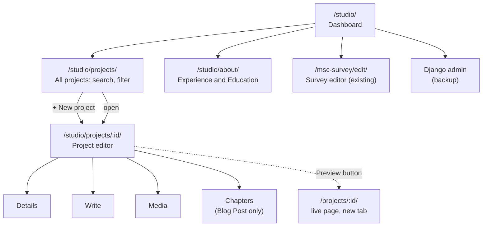
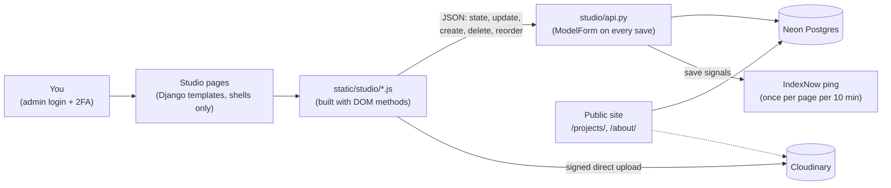
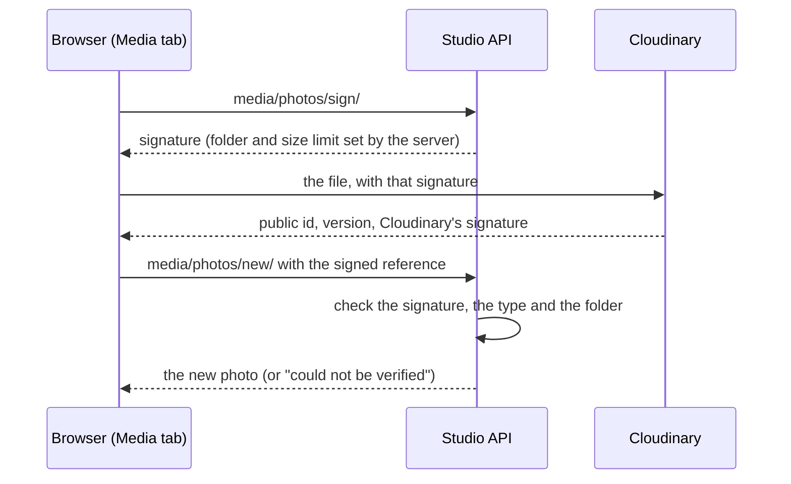

# Studio architecture: the website builder at /studio/

**Studio** is a website builder for the whole site. It replaces the Django admin for everyday content: projects (in **Portfolio** and **Blog Post** mode), their media, and the About page. It uses the same look and building blocks as the survey editor at `/msc-survey/edit/`.

Progress is tracked in [STUDIO_CHECKLIST.md](STUDIO_CHECKLIST.md). This file describes the design and is updated as each part ships.

> Diagrams are in Mermaid. GitHub draws them. In VS Code, install **Markdown Preview Mermaid Support** and press Ctrl+Shift+V.

**Status**

| Part | State |
| --- | --- |
| Dashboard, All projects, project editor (Details, Write, Chapters) | Built (PR 1) |
| Media tab (photos, videos, embeds) | Built (PR 2) |
| About page (`/studio/about/`) | Built (PR 3) |

---

## 1. Goals

- **No Django admin for day-to-day work.** Every project, photo, video, embed, card and About entry is editable in a friendly UI.
- **Google Forms-style editing:** cards, autosave, drag-and-drop with arrows, and phone-friendly.
- **The same rules as the admin:** the same validation (a ModelForm on every save), the same safe embeds, the same direct uploads to Cloudinary, and the same Bing (IndexNow) ping when content changes.
- **A reusable kit:** the editing building blocks live in one shared file, so the next builder is quick to make.
- **The Django admin stays** as a backup, and for users, 2FA devices and raw data.

---

## 2. Pages

| Page | What you do there |
| --- | --- |
| **Dashboard** | Counts (projects, featured, blog posts), shortcuts to everything, recent edits |
| **All projects** | Cards with thumbnail, name, year, category, Featured and mode badges. Search and filter by category, mode and featured. |
| **Project editor: Details** | Name, year, category (add new inline), Featured switch, Portfolio / Blog Post switch, technologies as chips (Portfolio only, since the Blog Post page hides them), thumbnail upload, delete |
| **Project editor: Write** | The description: a markdown editor with a toolbar, a formatted preview drawn in the page (no frame, so it can't steal typing focus), and Insert image from the project's photos. **Portfolio:** shown beside the cover image. **Blog Post:** the article intro. |
| **Project editor: Chapters** (Blog Post) | The article's sections, which the live page shows as **Chapters**: title, teaser, body, takeaways, image, placeholder. Reorder, plus import and export as markdown. |
| **Project editor: Media** | **Portfolio:** Videos, Photos and Embedded work, in the live page's order. Pick or drop several files; each goes straight to Cloudinary with its own progress row (photos up to 10 MB, videos up to 100 MB). Captions, drag or arrow reorder, delete. Embeds are pasted, checked and previewed. **Blog Post:** only the photo library, for images placed in the article (Copy markdown, or the Image button in Write). Videos and embeds are kept but not shown, since the live blog page doesn't show them. |
| **About page** | **Experience:** cards (click to open) with role, organisation, location, dates (shown as typed) and highlights, one bullet per line. **Education:** title and details, always open. Both have drag or arrow reorder, a Shown switch, and delete. New entries start **hidden** at the top, so placeholder text never reaches the live page. |

How the two modes show on the live page:

| Mode | Live project page |
| --- | --- |
| **Portfolio** | Description beside the cover → Videos → Photos → Embeds; technology list shown |
| **Blog Post** | Article intro beside the cover → Chapters (the cards); photos used inline in the text; no technology list |

---

## 3. How it fits together

- **Pages are shells:** each page loads its data from the API, the same pattern that passed CodeQL in the survey editor, so nothing is read back out of the page.
- **Every write** goes through a `ModelForm` with an explicit list of fields. The models' own `clean()` runs, including the embed safety check.
- **Uploads:** photos and videos go **straight from the browser to Cloudinary** with a signature from the server (`projects/direct_upload.py`, shared with the admin), so Heroku's 30-second limit never applies.

  The server never trusts the browser's reference on its own: it must carry Cloudinary's signature for this account, be the right type (image or video), and sit in that kind's folder. Removing a photo or video only removes it from the project. The file stays in Cloudinary, because a blog post's text may still show it by its address. Thumbnails and chapter images (10 MB or less) go through the server, inside their own database savepoint, so a failed upload reports a clear error and changes nothing.
- **Saves trigger the same signals as the admin,** so the IndexNow ping for changed pages keeps working. Autosave saves often, so `_ping_indexnow` in `projects/models.py` sends each page **at most once every 10 minutes** (a cache key per URL). Saving in the admin follows the same rule.

### The API

All under `/studio/api/`. Reads are GET, writes are POST with JSON (uploads use form data).

| Path | Does |
| --- | --- |
| `dashboard/`, `projects/` | Counts and recent edits; the list for All projects |
| `projects/new/`, `categories/new/` | Create a project (name and mode) or a category (reuses one with the same name) |
| `preview/` | Markdown to sanitised HTML, for the Write preview |
| `projects/<id>/` | GET: everything the editor needs. POST: save changed fields. |
| `projects/<id>/delete/`, `projects/<id>/upload/<field>/` | Delete; upload or remove the cover image |
| `projects/<id>/cards/new/`, `cards/<cid>/`, `cards/<cid>/delete/`, `cards/<cid>/upload/image/` | Chapter add, save, delete, image |
| `projects/<id>/cards/reorder/` | New order (must list exactly this project's chapters) |
| `projects/<id>/cards/import/`, `cards/export/` | Check or add markdown chapters (append or replace); download them as `.md` |
| `projects/<id>/media/<kind>/sign/` | A signature for one direct upload (`photos` or `videos`) |
| `projects/<id>/media/<kind>/new/` | Add a photo or video from a verified upload reference, or an embed from pasted code |
| `projects/<id>/media/<kind>/<mid>/`, `.../delete/`, `media/<kind>/reorder/` | Caption (and embed code), remove from the project, new order |
| `about/` | Experience and Education lists |
| `about/<kind>/new/`, `<kind>/<id>/`, `<kind>/<id>/delete/`, `<kind>/reorder/` | `experience` or `education`: add (hidden, at the top), save fields, delete, new order. A reorder also tells IndexNow about `/about/`, since it doesn't go through a save. |

---

## 4. The shared editor kit

`static/studio/kit.js` holds the building blocks every builder page needs:

| Piece | What it does |
| --- | --- |
| `h()` | Builds HTML with DOM methods and `textContent`, never HTML strings |
| `api()` | `fetch` with the CSRF token from the cookie and JSON in and out |
| Autosave queue | Saves each field about 0.7 s after typing stops; merges edits per item; shows *Saving… / Saved* or the reason in red |
| Field helpers | Text, number, textarea (auto-growing), select, switch, segmented buttons, chips; locked or disabled states; per-field errors |
| Drag and drop + arrows | The ⠇ handle on a laptop, ↑ ↓ everywhere; posts the new order |
| Uploads | `imageField`: server upload for small images, with Remove. `directUpload`: sign, send straight to Cloudinary with progress, return the signed reference; the page warns before you leave mid-upload. |
| Actions | `act()`: create, delete or reorder, with an optional confirm, then reload the state |

The survey editor was built first, with its own copy of these pieces. Moving it onto the kit is a later step (see the checklist), so the survey isn't touched while it waits for approval.

---

## 5. Access and safety

- **Who:** staff with **2FA**, the same check as the survey editor. Anyone else is redirected to the admin login, and API calls get a 403.
- **CSRF** on every write. Responses are `noindex, nofollow` and `no-store`.
- **Items are always looked up through their project,** so an id from another project gets a 404.
- **Embeds:** only one `<iframe>`, https only, from the allowed domains (YouTube, Vimeo, Instagram, Figma, itch.io, LinkedIn). That's the model's existing check.
- **Markdown preview** is rendered on the server by django-markdownify, with the site's bleach allow-list.

---

## 6. Where things live

| What | Where |
| --- | --- |
| App | `studio/` (views, api, urls, tests) |
| Pages | `templates/studio/` |
| Front end | `static/studio/kit.js` (shared) plus one script per page |
| Styles | `static/scss/scss-styles-pages/_studio.scss` |
| Content models (unchanged) | `projects/models.py` |
| Direct uploads (shared) | `projects/direct_upload.py` |

---

## 7. Testing

- **`studio/tests.py`** (`.venv\Scripts\python manage.py test studio`): access, dashboard, create, edit and validation, categories, delete, uploads with Cloudinary mocked (so nothing lands in the live library), the sanitised preview, chapters (add, edit, delete, reorder, other projects' chapters refused), import and export, and the IndexNow limit. Media: signatures fix the folder; forged, wrong-type and wrong-folder references are refused; embeds use the model's check; other projects' media are 404. References are signed in the tests with a stand-in secret, so nothing goes over the network.
- **Media click-through:** the browser's upload to Cloudinary is intercepted and answered with a file already in the library, signed so the server's real check runs. Nothing new is uploaded.
- **About:** the tests cover new entries starting hidden, show and hide on `/about/`, validation, reorder (and its IndexNow ping) and delete. The click-through saves the local entries' order first and puts it back afterwards, and its test entries are named "Studio QA" so they can be removed.
- **Browser click-through** in Edge on a laptop and a phone size, against the local database with a throwaway admin user. It covers every tab, autosave, the toolbar, the photo picker, import, drag and arrow reorder, the phone Write/Preview switch, no sideways scrolling, and no JavaScript errors.
