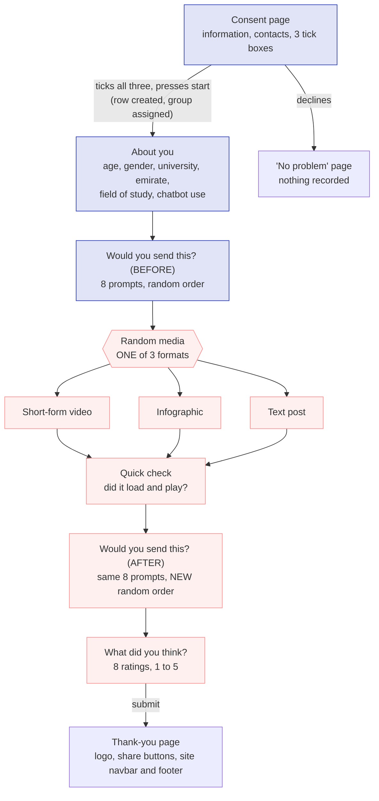
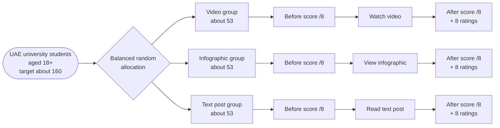
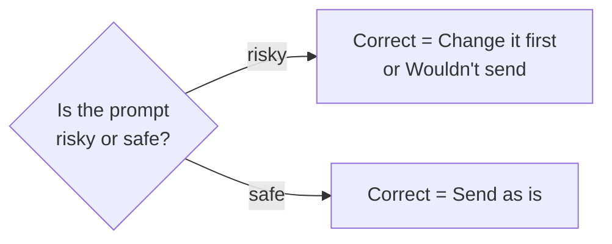
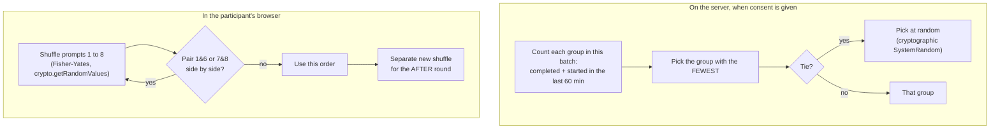
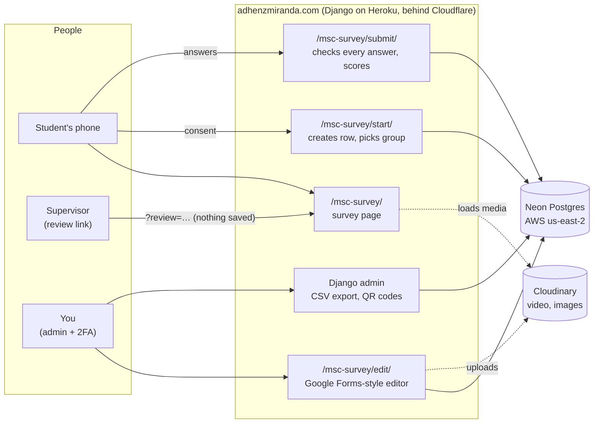
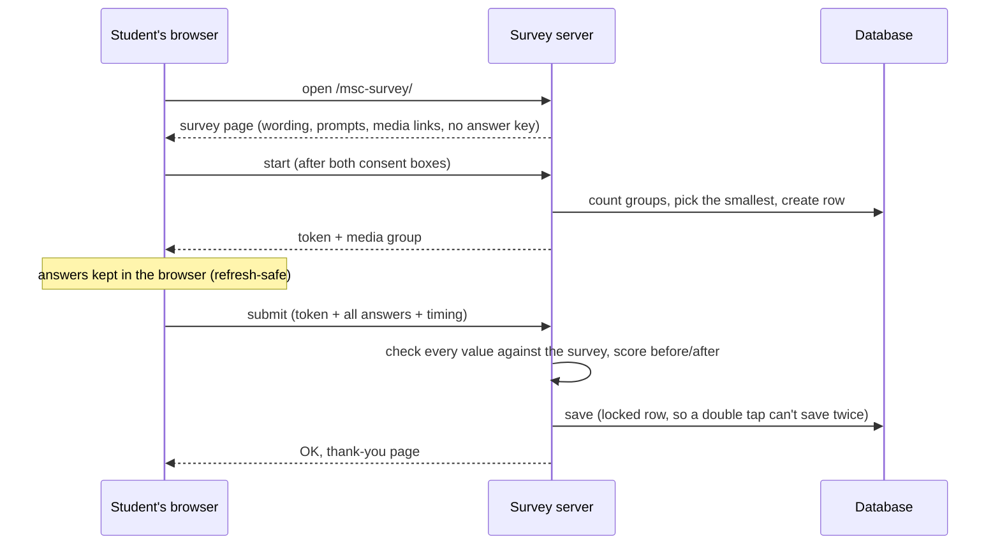

# Survey architecture: how "Think Before You Prompt" works

A one-place recap of the study design, the variables, the randomisation and the system behind
**adhenzmiranda.com/msc-survey/**. For step-by-step setup and go-live, see [SURVEY.md](SURVEY.md).

> The diagrams are written in Mermaid. GitHub draws them automatically. In VS Code, install the
> recommended **Markdown Preview Mermaid Support** extension, then open the preview (Ctrl+Shift+V).

---

## 1. The study in one paragraph

University students in the UAE decide whether they would send 8 example messages to a chatbot
(**before**). Each then sees **one** short piece of content about chatbot privacy, in one of three
formats chosen for them: a short-form video, an infographic or a text post. Then they decide on the
same 8 messages again, in a new order (**after**), and rate the content on 8 statements. The change
in their score shows how much each format helped.

**Research question:** which social media format best teaches UAE university students to stop
sharing sensitive information with AI chatbots?

---

## 2. What a participant goes through

- **Blue steps:** Back works, so people can fix their details or their "before" answers.
- **Red steps:** Back is turned off from the media onwards, so nobody can change their "before" answers
  after seeing the message. This protects the pre-test.
- **About 10 minutes.** Progress survives a refresh. A second visit from the same phone shows "You've already
  taken part".

---

## 3. The experimental design

It's a **3 × 2 mixed design**:

| Factor | Type | Levels |
| --- | --- | --- |
| Message format | **Between** people (each person gets one) | Video, Infographic, Text post |
| Time | **Within** people (everyone does both) | Before, After |

---

## 4. Variables

### Independent variable (what you change)

| Variable | Levels | How it's set | CSV column |
| --- | --- | --- | --- |
| **Message format** | Short-form video · Infographic · Text post | Balanced random allocation by the server | `media_group` (`video`, `infographic`, `text`) |

### Dependent variables (what you measure)

| Variable | Measure | Range | CSV columns |
| --- | --- | --- | --- |
| **Privacy decision accuracy (main)** | Correct choices on the 8 prompts | 0 to 8, before and after | `before_score`, `after_score` |
| **Change (main outcome)** | After minus before | −8 to +8 | `score_change` |
| Per-prompt choices | send / change / dont_send, and whether each was correct | 1 / 0 | `before_p1` … `after_p8`, `…_correct` |
| Engagement | Mean of 2 ratings | 1 to 5 | `mean_engagement` |
| Self-efficacy ("I can do this") | Mean of 2 ratings | 1 to 5 | `mean_self_efficacy` |
| Response efficacy ("this would protect me") | Mean of 2 ratings | 1 to 5 | `mean_response_efficacy` |
| Intention to act | Mean of 2 ratings | 1 to 5 | `mean_intention` |

### Process and data-quality measures

| Measure | What it tells you | CSV column |
| --- | --- | --- |
| Time on the media page | Exposure, for every format | `media_seconds` |
| Video watched / finished | Did the video group actually watch? | `video_watched_seconds`, `video_finished` |
| Content loaded | Exclude people whose media didn't load | `content_loaded` |
| Total time | Speeding through | `total_minutes` |
| When they took part | UAE local time (exact UTC copies at the end of each row) | `started_uae`, `completed_uae` |
| Prompt orders shown | Check for order effects | `before_order`, `after_order` |
| Recruitment source | Where people came from (QR tag, shared link) | `source` |

### Constants (identical for everyone, so only the format differs)

- **The script:** the same hook, warning and 6 tips, word for word, in all three formats.
- **The 8 prompts:** the same prompts in both rounds, with the same answer options and the same scoring.
- **The ratings:** the same 8 statements in the same order.
- **Everything around the media:** the same consent page, demographics, instructions, platform and design.
- **The mock posts:** the same account name and look, with no likes or view counts (social proof would sway answers).
- **The randomisation rules:** the same prompt-order rules for everyone (section 6).

### Control variables / covariates (measured, not changed)

| Variable | Why | CSV column |
| --- | --- | --- |
| **Before score** | The key covariate (ANCOVA) | `before_score` |
| Age, gender | Standard demographics | `age`, `gender` |
| University, emirate | Sampling spread. Universities are reported only as A, B, C | `university`, `emirate` |
| Field of study | IT and cyber students may already know more. 9 options, merged for analysis into **IT / Cybersecurity**, **Other STEM** (Engineering, Science, Health) and **Non-STEM** (everything else) | `field_of_study` |
| Chatbot use | Experience with the tools | `chatbot_use` |

### Possible confounds (name them in the limitations)

- **Exposure time differs:** the video runs a fixed 51 s, while reading is self-paced (check `media_seconds`).
- **Video extras:** only the video has music and an opening example of someone typing a fake ID.
- **Repetition:** the same prompts twice may push "after" scores up for everyone.
- **No control group:** there's no "no message" group.
- **Stated, not real, behaviour:** answers are intentions, not actual chatbot behaviour.
- **Convenience sampling.**

---

## 5. Scoring: the "Would you send this?" task

Each answer is **correct** or **wrong**:

Scoring safe prompts as well means someone who refuses everything scores **4 / 8**, not 8 / 8. Both
carelessness and blanket over-caution count as errors.

| # | Message (short) | Screenshot / context | Key | Pair |
| --- | --- | --- | --- | --- |
| 1 | Recreate this visa form layout | Visa form **filled in** | Risky | A |
| 2 | Turn lecture slides into a quiz | Lecture slide | Safe | |
| 3 | Summarise this group chat | Group chat with others' numbers and grades | Risky | |
| 4 | "My Emirates ID is 784-XXXX…", which fields ask for it? | (masked placeholder) | Safe | |
| 5 | Why does my banking app show this error? | Banking app with account number | Risky | |
| 6 | Recreate this visa form layout | Visa form **blank** | Safe | A |
| 7 | "Based on everything you remember about me…" safest airline | Chatbot memory with passport, religion | Risky | B |
| 8 | Which airlines have the best safety record? | Same memory | Safe | B |

- **Matched pairs:** 1 & 6 (same words, different screenshot) and 7 & 8 (same memory, different
  request). They test whether people **tell the difference**, not just react to scary words.
- **Optional trickier swaps** for prompts 2 and 5, which need supervisor approval: see SURVEY.md.

**Answer options** under every prompt, always in this order (least to most cautious):
**Send as is → Change it first → Wouldn't send**.

---

## 6. Randomisation

| What | Random? | Detail |
| --- | --- | --- |
| **Media group** | Balanced random | Fills the smallest group; ties broken with cryptographic randomness. Groups stay even, but nobody can predict the next one. Fixed once assigned; a refresh never changes it. Balanced separately per batch (pilot / main). |
| **Prompt order (before)** | Yes, per person | Cryptographically secure shuffle; matched pairs never adjacent |
| **Prompt order (after)** | Yes, a new one | Different from the "before" order |
| Answer options | No, fixed | Send as is → Change it first → Wouldn't send |
| Demographics, ratings | No, fixed | The same order for everyone |

**For the methods chapter:**
> Participants were assigned to one of three conditions using balanced allocation (assignment to the
> least-filled condition, with ties broken at random using a cryptographically secure generator). The
> order of the eight prompts was independently randomised for each participant and for each round
> (Fisher-Yates shuffle with a cryptographically secure generator), with matched prompts never
> presented consecutively.

---

## 7. The system

### What happens when a student takes part

### Safety rules built in

- **Status:** **Draft** (only you, via preview or the review link) → **Open** (collecting) → **Closed** (shows the closed page).
- **Opening checks:** the survey **won't open** until the contacts, ethics reference and media for every group are filled in.
- **Locking:** once anyone responds, the content **locks**, so every response answered the same survey. Change it only by duplicating it as a new version.
- **Server-side scoring:** answers are checked and scored **on the server**. Nothing the browser claims is trusted.
- **Rate limit:** 300 starts or submits per hour per network (classrooms share one IP address).
- **Previews never save:** your preview and the supervisor's review link never save anything.
- **Taking part once:** a soft check, because a hard block would mean tracking people.
  - A consent tick box: "I haven't taken part in this survey before."
  - The browser remembers a submission and shows "You've already taken part".
  - Each start's one-time token can only be submitted once.
  - In the analysis: flag rows with the same age, gender, university, emirate and field of study started close together.
- **Universities stay anonymous:** the consent page promises they're reported only as University A, B, C, and are never compared or ranked on their own.

### What is stored, and what never is

| Stored (per response) | Never stored |
| --- | --- |
| Random token, survey version, batch, source tag | Name, email, student ID |
| Media group, start and finish times | IP address (used briefly for rate limiting only) |
| Demographic answers, the 16 prompt choices, 8 ratings | Device or browser details |
| Scores (computed on the server), timing, orders shown | Cookies or any tracking |

---

## 8. Analysis plan (summary)

- **Main test:** **ANCOVA**. After-score by format, controlling for the before-score. Report effect sizes.
- **Backup:** Kruskal-Wallis on `score_change` if the assumptions fail.
- **Ratings:** compare construct means between formats. Report the correlation within each pair of statements.
- **Power:** about 160 people in 3 groups can detect a **medium** effect.
- **Proposed exclusions** (decide before data collection):
  - the content didn't load
  - the attention check failed (if one is added)
  - under 5 seconds on the media page
- **Example hypotheses:**
  - **H1:** accuracy improves from before to after
  - **H2:** the improvement differs by format
  - **H3:** engagement is highest for video
  - **H4:** self-efficacy and response efficacy predict intention

---

## 9. Where things live

| What | Where |
| --- | --- |
| Survey wording, prompts, media | In the **database**: edit at `/msc-survey/edit/` |
| Starting content (first install only) | `survey/seed.py` |
| Scoring, balancing, progress | `survey/logic.py` |
| Answer checks | `survey/validation.py` |
| Survey page, start, submit, review link | `survey/views.py` |
| Editor API | `survey/editor.py` |
| CSV export | `survey/export.py` |
| Participant front end | `static/survey/survey.js`, `static/scss/scss-styles-pages/_survey.scss` |
| Editor front end | `static/survey/editor.js`, `static/scss/scss-styles-pages/_survey-editor.scss` |
| Media drafts (not in git) | `survey_media/` |
| Tests | `survey/tests.py`, `survey/test_editor.py` |
